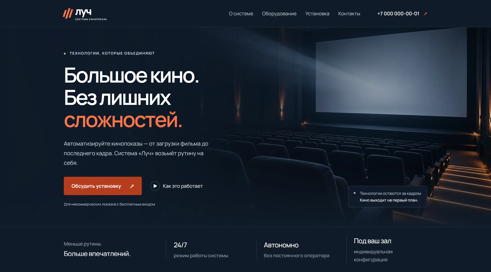
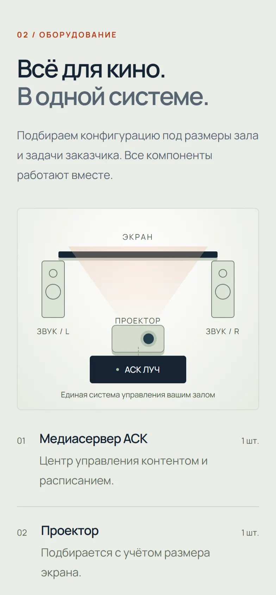
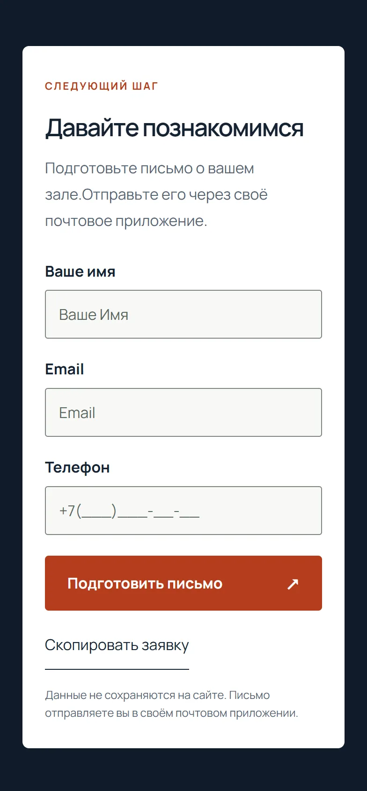

# ASK Luch — Cinema Automation Website

A responsive, Russian-language business website for **ASK Luch**, a system that automates non-commercial cinema screenings. The frontend presents a technical product through a clear visual story: how it works, what equipment is involved, how installation is planned, and how to get in touch.

**[View live website](https://ikatenev.github.io/ASK/)** · **[View quality checks](AUDIT.md)**

## Preview

[](https://ikatenev.github.io/ASK/)

<p align="center">
  
  
</p>

## Project overview

The goal of the website is to make a specialised cinema automation product understandable to potential business customers, without overwhelming visitors with technical details.

The page brings together:

- **Product introduction:** a focused hero section and clear calls to action.
- **How it works:** a three-step explanation of scheduling, content delivery and automatic screenings.
- **Equipment overview:** a labelled visual diagram of the connected cinema components.
- **Installation information:** practical requirements and a route to discussing a setup.
- **FAQ and contacts:** answers to common questions and ways to prepare an enquiry.

## Frontend features

- **Responsive design** for desktop, tablet and mobile screens, with a custom visual identity and CSS-based illustrations.
- **Accessible mobile navigation** with keyboard support, focus management and an overlay that does not shift the page content.
- **Interactive FAQ** using native `<details>` elements and motion-aware transitions.
- **Video walkthrough** in a native `<dialog>`, with deferred loading and a direct MP4 fallback.
- **Enquiry assistance** with input validation, a phone-number mask, a pre-filled email draft and a copy-to-clipboard alternative.
- **Performance-focused delivery:** local Manrope font subsets, optimised WebP images, CSS/JavaScript minification and minimal third-party dependencies.
- **Accessibility and metadata:** semantic markup, visible focus indicators, reduced-motion support, SEO/Open Graph metadata and a content security policy.

## Tech stack

**HTML5 · CSS3 · Vanilla JavaScript · esbuild · GitHub Actions · GitHub Pages**

The site is intentionally built without a runtime frontend framework. JavaScript handles interface behaviour; the static build prepares the production files for GitHub Pages.

## Performance and testing

The latest saved **local simulated-mobile Lighthouse** audit of the corrected build reported:

| Performance | Accessibility | Best Practices | SEO |
|:-----------:|:-------------:|:--------------:|:---:|
| 98 | 100 | 100 | 100 |

These are laboratory results from a local production preview, **not real-user measurements or a live GitHub Pages audit**. Results can vary by device and network.

- `npm test` checks build output, assets and public configuration.
- Additional browser checks cover responsive layouts, mobile navigation, FAQ interactions, video dialog behaviour and contact tools.
- The [technical audit](AUDIT.md) records the measurement setup, improvements and limitations. Accessibility testing does not constitute WCAG certification; video accessibility requires manual review.

## Run locally

Requires **Node.js 24**.

```bash
git clone https://github.com/IKatenev/ASK.git
cd ASK
npm ci
npm run build
npm test
node scripts/serve.mjs
```

Open `http://127.0.0.1:18745/ASK/` to preview the production build.

## Project structure

```text
index.html                  Main page markup
style.css, media.css        Core and responsive styling
js/main.js                 Interactive frontend functionality
images/, fonts/, video/     Local media and typography
scripts/build.mjs          Static production build
.github/workflows/pages.yml  GitHub Pages deployment
tests/                      Build and browser checks
AUDIT.md                    Technical audit and measurements
```

## Deployment and enquiry behaviour

The public site is hosted on **GitHub Pages**. It is a static frontend, not the underlying cinema automation software.

The enquiry form **does not send data to a server**: it prepares an email in the visitor's own mail application or lets the visitor copy the enquiry text. No enquiry is stored by this website. A production form with server-side delivery would require a separate backend or form service.

The hero background is AI-generated illustrative imagery, not a photograph of an actual customer installation. No business performance or conversion results are claimed.

**Frontend implementation and redesign:** [Ivan Katenev](https://www.upwork.com/freelancers/ivankatenev). Product identity and business information belong to their respective owners.
